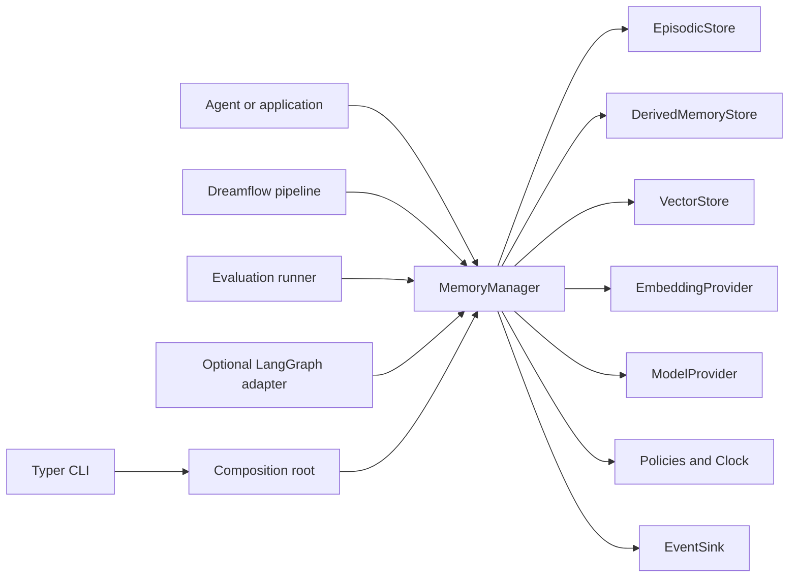

# memcave architecture

memcave is a framework-independent library for persistent agent memory. Version 0.1 stores an append-only episode log, maintains versioned derived memories, retrieves both, and evaluates that behavior with a reproducible harness.

The database is the source of truth. Markdown, including `memory.md`, is an export.

This document is the structural design for 0.1. Field-level rules live in [memory-model.md](memory-model.md). The benchmark lives in [evaluation.md](evaluation.md). Privacy controls live in [threat-model.md](threat-model.md). The decision record is [ADR 0001](adr/0001-architecture.md).

## Repository constraints

Phase 0 inspected `github.com/mk-hasan/memcave` at commit `aca0825`.

| Item | Finding |
| --- | --- |
| Tracked files | `LICENSE` (Apache-2.0) and `README.md` containing only the title `memcave` |
| Application code | None |
| Packaging, tests, CI | None |
| License conflict | None. Apache-2.0 stays. The license appendix still has the upstream placeholder copyright line. |
| Names | The repository, distribution, import package, and CLI are `memcave`. The offline consolidation pipeline is `dreamflow`. |

Established code conventions do not exist yet. Later phases will follow this design and the Python practices named in the project brief: Python 3.12+, Pydantic v2, SQLAlchemy 2 async, Alembic, pytest, Ruff, mypy, and Typer.

## System context



Callers use `MemoryManager`. They do not receive SQLAlchemy sessions, driver connections, or vendor SDK clients.

The lifecycle is:

1. Capture observable session events.
2. Apply unambiguous explicit memory instructions immediately.
3. Extract candidates from eligible sessions during dreamflow.
4. Validate, classify, deduplicate, and detect conflicts.
5. Write versioned derived memories with evidence.
6. Retrieve episodic and derived memory under a token budget.
7. Evaluate strategies on fixed fixtures.
8. Soft-delete memories, or erase a user’s stored data.

## Package layout

```text
src/memcave/
  domain/          pydantic models, enums, errors, request and response types
  ports/           protocols
  services/        MemoryManager, retrieval, index, erasure, instruction application
  dreamflow/        pipeline stages and structured extraction schemas
  evaluation/      strategies, metrics, runner, reports, fixtures
  adapters/
    memory/        in-memory stores
    sqlite/        SQLite stores
    postgres/      PostgreSQL and pgvector stores
    embeddings/    fake provider
    models/        fake provider and optional OpenAI provider
  db/              SQLAlchemy tables and Alembic migrations
  bootstrap.py     composition root
  cli/             Typer commands
  integrations/
    langgraph/     optional tools, hooks, and example agent
  dashboard/       optional Streamlit report viewer
```

`domain`, `ports`, `services`, `dreamflow`, and `evaluation` are the core. They must not import LangGraph, Streamlit, FastAPI, asyncpg, pgvector, OpenAI, SQLAlchemy, or adapter modules. `db` may use SQLAlchemy. Only sqlite and postgres adapters, the CLI migrate command, and Alembic may import `db`.

A unit test will parse those core packages and fail on a forbidden import.

Optional integrations import their third-party packages inside the integration module. `memcave/__init__.py` exports `MemoryManager` and public models only. Importing `memcave` must succeed with the base dependencies alone.

## Dependencies

Base install:

| Package | Role |
| --- | --- |
| pydantic | Domain and API models |
| pydantic-settings | CLI and environment configuration |
| sqlalchemy | SQLite persistence |
| alembic | Migrations shipped inside the package |
| aiosqlite | Async SQLite driver |
| typer | CLI |

Optional extras:

| Extra | Packages | Enables |
| --- | --- | --- |
| `postgres` | `asyncpg`, `pgvector` | PostgreSQL adapter and vector column |
| `langgraph` | `langgraph` | Tools, hooks, example agent |
| `openai` | `openai` | One real model provider |
| `dashboard` | `streamlit` | Local benchmark dashboard |
| `dev` | pytest, pytest-asyncio, pytest-cov, ruff, mypy, pre-commit, build | Development and CI |
| `all` | the extras above | Full local install |

Not in 0.1: FastAPI, NumPy, a tokenizer package, a separate search engine, CrewAI, AutoGen, and hosted vector-database clients.

Supported runtime for CI is Python 3.12. The package declares `requires-python >= 3.12`. The Phase 7 workflow also runs 3.13.

## Composition

`MemoryManager` receives its collaborators through the constructor. There is no service locator.

```python
class MemoryManager:
    def __init__(
        self,
        episodic_store: EpisodicStore,
        derived_store: DerivedMemoryStore,
        vector_store: VectorStore,
        embedding_provider: EmbeddingProvider,
        model_provider: ModelProvider,
        clock: Clock,
        event_sink: EventSink,
        redaction_policy: RedactionPolicy,
        retention_policy: RetentionPolicy,
        write_policy: MemoryWritePolicy,
        tracer: Tracer,
        reranker: Reranker | None = None,
        *,
        retrieval_config: RetrievalConfig | None = None,
        pipeline: DreamflowPipeline | None = None,
    ) -> None: ...
```

`Clock.now()` may be synchronous. Every method that performs I/O is asynchronous, including in-memory adapters.

The default `Reranker` returns its input unchanged. The default `Tracer` records nothing. Tests inject a fixed clock.

`bootstrap.build_manager(settings)` reads configuration, constructs adapters, and returns a manager. Domain code does not call the composition root.

## Public operations

Request and response bodies are Pydantic models. Identifiers are UUID4. Timestamps are timezone-aware UTC. Naive datetimes are rejected.

| Method | Effect |
| --- | --- |
| `start_session` | Create a session scoped to a tenant and user. |
| `append_event` | Append one immutable event. Apply an unambiguous explicit instruction in the same transaction. |
| `end_session` | Mark the session ended and eligible for dreamflow. |
| `search_memory` | Hybrid search across requested memory kinds. Return ranked hits, score components, and an untrusted context block. |
| `fetch_memory` | Return one derived memory, optionally at a version or `as_of` time. |
| `add_memory` | Create version 1 immediately and embed it. |
| `update_memory` | Require `expected_version`. Insert version `n + 1`. Audit the change. |
| `delete_memory` | Soft-delete and retain the normalized hash for suppression. |
| `get_memory_index` | Render the compact index from active rows. |
| `run_dreamflow` | Execute the pipeline and persist the run. |
| `export_markdown` | Write a sanitized `memory.md` tree under a caller-chosen directory. |
| `erase_user_data` | Hard-delete that user’s stored content in the tenant and write an audit event that contains counts, not payloads. |

Errors raised through the public API are memcave domain errors: `NotFoundError`, `TenantIsolationError`, `ScopeError`, `VersionConflictError`, `PolicyRejectedError`, `ValidationError`, `ProviderError`, and `DreamflowError`. Adapters translate driver exceptions before they leave the adapter.

## Configuration

`memcave init` creates `.memcave/config.toml` and a SQLite file. Environment variables prefixed with `MEMCAVE_` override the file. Defaults:

```toml
[storage]
backend = "sqlite"
dsn = "sqlite+aiosqlite:///./.memcave/memcave.db"

[embeddings]
provider = "fake"
dimension = 64

[model]
provider = "fake"
temperature = 0.0
seed = 0

[retrieval]
top_k = 8
token_budget = 2000
recency_half_life_days = 30

[safety]
redact_queries = true
review_confidence_threshold = 0.60
auto_resolve_confidence_threshold = 0.85
duplicate_cosine_threshold = 0.92
```

Derived score weights default to vector 0.30, lexical 0.20, recency 0.15, importance 0.20, and confidence 0.15. Episodic weights default to vector 0.40, lexical 0.30, recency 0.20, and importance 0.10. Episodic confidence is not a truth score: an event records that something was observed. Its confidence component is fixed at 1 and is omitted from the episodic weight vector so it cannot dominate.

`top_k` is limited to 1..50. `token_budget` defaults to 2000 and is limited to 1..8000.

## Ports

| Port | Responsibility |
| --- | --- |
| `EpisodicStore` | Append events, list them by scope and filter, update processing columns, erase a user’s events |
| `DerivedMemoryStore` | Persist records, versions, evidence, conflicts, and hash checks |
| `VectorStore` | Upsert, search, and delete embeddings for a tenant |
| `EmbeddingProvider` | Embed a batch and expose `dimension` |
| `ModelProvider` | Return structured text plus token counts for a named task |
| `Clock` | Provide the current UTC instant |
| `EventSink` | Accept audit events |
| `RedactionPolicy` | Replace secret-shaped text with `[REDACTED]` |
| `RetentionPolicy` | Decide whether a session or event is still eligible to keep |
| `MemoryWritePolicy` | Reject empty content, cross-tenant writes, and illegal status transitions |
| `Reranker` | Reorder hits after fused scoring |
| `Tracer` | Open spans with `memcave.*` attributes |

Store methods take a `TenantScope` as their first argument. A method that lists every tenant is not part of the port. Shared contract tests run the same suite against the in-memory adapter, SQLite, and, when marked, PostgreSQL.

## Persistence

SQLAlchemy 2 async models and Alembic migrations cover:

- `tenants`
- `users`
- `sessions`
- `session_events`
- `memory_records`
- `memory_versions`
- `memory_evidence`
- `memory_embeddings`
- `dreamflow_runs`
- `dreamflow_items`
- `audit_events`
- `benchmark_runs`
- `benchmark_results`
- `engine_metadata` for the embedding dimension and schema markers

Migrations live in the installed package so `memcave migrate` works after installation. A repository `alembic.ini` points at the same script location for local development.

Indexes support tenant and user filters, session chronology, unprocessed-event selection, active-memory filtering, category lookup, and PostgreSQL vector and lexical retrieval. Column definitions and uniqueness rules are in [memory-model.md](memory-model.md).

SQLite stores embeddings as JSON and ranks them in Python with cosine similarity. PostgreSQL additionally stores `vector(N)` and uses a cosine index when the `postgres` extra is installed. Both paths implement the same `VectorStore` contract. Contract fixtures use 64-dimensional vectors and assert ranking order, tenant filtering, and deletion.

Lexical search is FTS5 on SQLite and `tsvector` on PostgreSQL. The in-memory adapter uses the same tokenization rules as the SQLite lexical scorer: casefold, split on non-alphanumeric characters, and score overlap as `|query ∩ document| / |query|`.

## Retrieval

`search_memory` does the following:

1. Validate scope, `top_k`, and token budget.
2. Redact the query before logging, embedding, and lexical matching when `redact_queries` is true.
3. Embed the redacted query.
4. Apply hard filters independently to episodic events and derived versions.
5. Score the survivors with that kind’s weight vector.
6. Min-max normalize fused scores within each kind. A single survivor maps to 1. An empty component, such as a missing embedding, contributes 0.
7. Merge the lists, sort by normalized score, then importance, then recency, then identifier.
8. Pass the merged list to the reranker. On reranker failure, keep the fused order and record the failure in the response metadata.
9. Keep at most `top_k` hits whose estimated tokens fit the budget. The estimate is `ceil(character_count / 4)`. If the first hit alone exceeds the budget, keep that one hit and set `truncated=true`.
10. Render the untrusted context block.
11. Emit one audit event containing a query hash, a redacted query truncated to 500 characters, and hit identifiers.

Hard filters drop other tenants, other users’ user-scoped rows, and rows whose status is `deleted`, `archived`, `superseded`, or `stale`. They also drop `candidate` rows unless the request includes them, rows outside the `as_of` validity window, and rows the caller is not allowed to read. Default `as_of` is `clock.now()`. Default search includes the caller’s user-scoped rows and tenant-shared rows.

Recency is `0.5 ** (age_days / half_life_days)`. Cosine similarity in `[-1, 1]` is mapped with `(cosine + 1) / 2`.

Each `RetrievalHit` includes `score_components` with the raw component values, the weights used, the pre-normalization fused score, and the post-normalization score. The response also names which components were unavailable.

Episodic importance defaults are 0.3 for ordinary messages, 0.6 for `final_answer` and `explicit_memory_instruction`, and 0.5 for the other event types. Derived importance is the value stored on the version.

## Memory index and export

`get_memory_index` groups active, in-window memories by category and logical path. It does not write a file and does not create a second stored copy as the source of truth.

`export_markdown` writes:

```text
memory.md
profile/
preferences/
domain_knowledge/
projects/
workflows/
corrections/
constraints/
```

Logical paths are generated from the category and a slug of the title. Allowed characters are lowercase ASCII letters, digits, `/`, `_`, and `-`. The renderer rejects `..`, backslashes, absolute paths, empty segments, and more than four segments. Collisions get a numeric suffix. Export writes only after confirming that every destination resolves inside the output directory.

The index entry is a title, path, category, status, confidence, and one-line summary. It is small enough to inject at session start. Full content stays behind `fetch_memory` and `search_memory`.

## Dreamflow

The pipeline is a sequence of replaceable stages:

| Stage | Responsibility |
| --- | --- |
| `SessionSelector` | Choose ended, in-retention, not opted-out sessions that are pending or failed |
| `CandidateExtractor` | Produce schema-valid candidates with evidence event ids |
| `CandidateValidator` | Drop candidates with no evidence, empty content, or illegal fields |
| `CandidateClassifier` | Assign a category using rules, with an optional model suggestion |
| `DuplicateDetector` | Merge true duplicates into the existing version’s evidence |
| `ConflictDetector` | Classify contradiction, temporal change, preference override, or scope clash |
| `ConsolidationPlanner` | Choose create, version, merge, supersede, archive, skip, or review |
| `MemoryWriter` | Apply the plan transactionally and idempotently |
| `IndexRegenerator` | Render the index and store that rendering on the run report |
| `RunReporter` | Persist counts, rejects, conflicts, and errors |

A run is idempotent on `(pipeline_version, tenant, user scope, session id)`. The writer is also idempotent on the active content hash. Retry resumes failed items. A session is marked processed only after its write commits. Crashing after the memory write and before the session mark is safe because the retry is absorbed by the duplicate check.

Each selected session is one transaction. A run may finish `succeeded`, `partial`, or `failed`. Zero eligible sessions is success.

Extraction uses structured output validated by Pydantic. The model port returns text and usage. The stage parses and validates it. Invalid JSON is retried once. A second failure stores the item as rejected and continues the run.

The 0.1 extractor has a rule-based path and a model-assisted path. Benchmarks and CI use the rule-based path and the fake model. The OpenAI provider is optional and is not required for correctness tests.

Conflict handling:

- Same tenant, user, and category, with a matching normalized hash, or cosine similarity at or above 0.92 plus the same subject key and no contradiction cue: duplicate. Link new evidence. Do not create a version. Similarity alone does not merge.
- Same identity with a negation or replacement cue, or a different value for the same structured key: conflict.
- A conflict with confidence at or above 0.85 and a clear temporal boundary: write a new version, close the previous validity window, and keep both windows searchable through `as_of`.
- A conflict that replaces the current fact outright: write a new version and mark the previous version superseded.
- Confidence below 0.60, invalid model output, or disagreement between the rule and the model: status `candidate`, resolution `needs_review`.

The run report records which strategy made the decision. It does not claim that an automatic resolution is certain.

## Explicit instructions

Unambiguous `remember`, `correct`, `forget`, and `temporal_change` instructions are applied when the event is appended. They do not wait for dreamflow. The event is then marked processed so dreamflow does not create a second memory. The duplicate and suppression checks are still the backstop.

`forget` soft-deletes the matched active memory. Dreamflow must not recreate a suppressed hash. A later explicit `remember` for the same content may create a new record.

Opt-out blocks dreamflow and automatic prompt injection. An explicit `add_memory` or parsed remember from that same user still works, because the user is asking for the write. `erase_user_data` remains available.

## Safety controls in the architecture

- Tenant scope is part of every store call.
- User scope is either one user or a tenant-shared row with a null user id.
- Redaction runs before persistence and again when rendering context.
- Audit events cover writes, updates, soft deletes, erasures, exports, dreamflow runs, and searches.
- Retrieved memory is wrapped as untrusted data. The renderer escapes its own delimiter if that delimiter appears inside content.
- Hidden model reasoning, environment variables, and detected credentials are not persisted.
- Readiness for prompt injection is covered by unit tests and by the adversarial benchmark cases.

Details and residual risks are in [threat-model.md](threat-model.md).

## LangGraph integration

The optional package calls `MemoryManager`. It does not open a private database connection.

It provides:

- tools for search, fetch, add, update, and delete
- hooks for session start, event capture, and session end
- configurable injection of the compact index at session start
- one example agent using the fake model so the example runs without a key

The session-start hook skips injection when the user or session has opted out. Tool implementations pass the manager’s context block into the graph state and reject memory payloads as a source of tool names.

## Evaluation placement

The runner depends on `MemoryManager` and `ModelProvider`. Strategies are interchangeable behind a `MemoryStrategy` protocol. The five initial strategies, the fairness rules, and the fixture catalog are specified in [evaluation.md](evaluation.md).

## CLI

The `memcave` command is a thin Typer application over the composition root.

| Command | Behavior |
| --- | --- |
| `memcave init` | Create local config and a SQLite database |
| `memcave migrate` | Upgrade to the current Alembic revision |
| `memcave session list` | List sessions for a tenant and optional user |
| `memcave memory search` | Run hybrid search and print hits |
| `memcave memory show` | Print one memory and its version metadata |
| `memcave memory export` | Write the Markdown tree |
| `memcave dreamflow run` | Run dreamflow for a tenant and optional user |
| `memcave benchmark run` | Execute strategies on fixtures |
| `memcave benchmark report` | Render JSON or Markdown from a saved run |
| `memcave user erase` | Erase one user in one tenant |

`user erase` defaults to a dry run that prints counts. Deletion runs only with `--yes`. Search and erase require an explicit tenant. The default database is the local SQLite file from `init`.

## Observability

Spans wrap session writes, search, dreamflow stages, and benchmark cases. Attributes include operation name, tenant id, duration, and result counts. They do not include raw memory content, queries, or secrets. `EventSink` is the audit log. The tracer is for operational timing and can later be bridged to an OpenTelemetry SDK by implementing the same port.

## Quality gates

| Gate | 0.1 setting |
| --- | --- |
| Ruff | Format and lint, Python 3.12, line length 100 |
| mypy | Strict on `domain`, `ports`, `services`, `dreamflow`, and `evaluation` |
| pytest | Default suite excludes the `postgres` marker |
| coverage | At least 85% branch coverage on those core packages |
| pre-commit | Ruff and mypy |
| GitHub Actions | Lint and types, core tests, package build, SQLite migration, PostgreSQL job, LangGraph job |

The coverage gate measures meaningful core behavior. Adapter confidence comes from the shared contract suite, not from lowering the core threshold or adding assertions that only touch imports.

A pull request fails when formatting, typing, core tests, migrations, or the package build fails.

## Extension points left unimplemented

Later versions can add, without changing `MemoryManager`:

- more `ModelProvider` adapters
- more `VectorStore` adapters
- agent-framework packages that follow the LangGraph pattern
- a FastAPI process that calls the public API
- an OpenTelemetry SDK tracer
- database row-level security on PostgreSQL

The roadmap must describe these as future work, not as current compatibility.

## Documentation map for later phases

| Document | Phase |
| --- | --- |
| README and five-minute SQLite quickstart | 7, with the SQLite example started in 3 |
| PostgreSQL and pgvector setup | 3 and 7 |
| LangGraph example | 5 |
| Memory lifecycle and dreamflow narrative | 4 and 7, consistent with this design |
| API reference stubs | 7 |
| Privacy narrative for users | 7, consistent with the threat model |
| Contribution, security, conduct, changelog, issue and pull-request templates | 7 |
