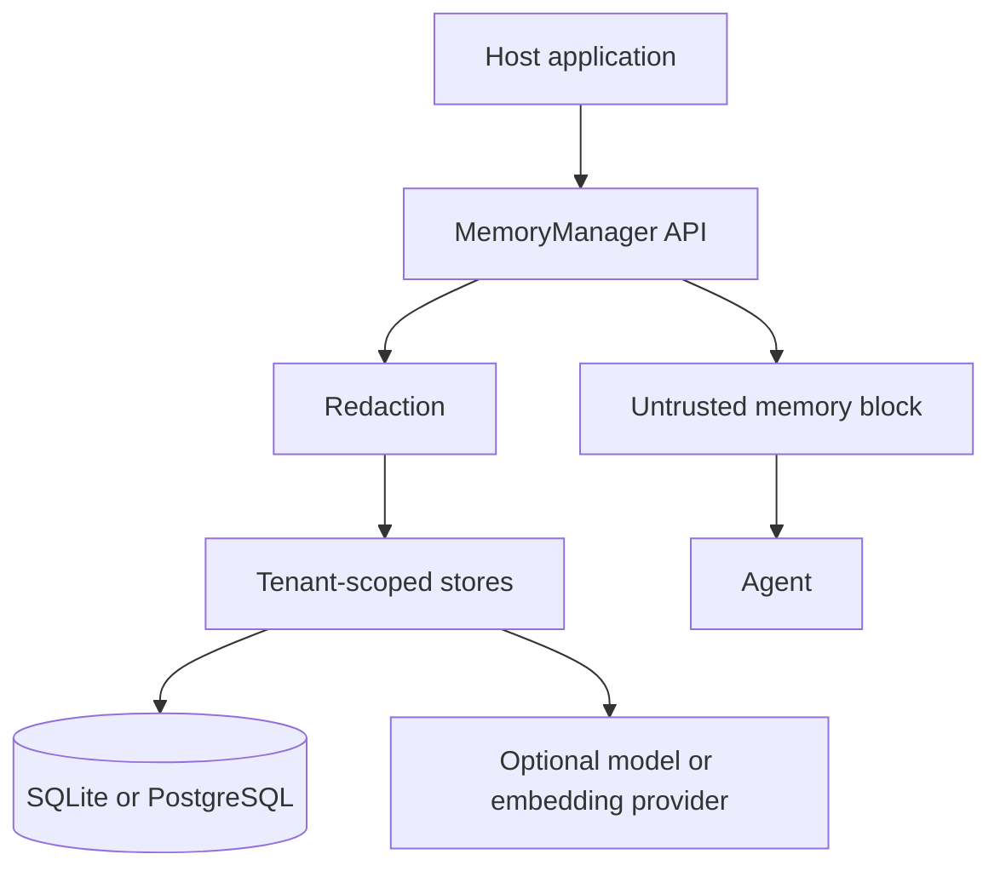

# Threat model

This document describes the 0.1 trust boundaries, abuse cases, and controls for memcave. It is a design for review. Controls become enforceable when the corresponding code and tests exist.

memcave stores memories about people and projects. Retrieved memory is data that an agent might trust by mistake. The design treats that as the central product risk.

## System under consideration

In scope for 0.1:

- the library, CLI, SQLite adapter, PostgreSQL adapter, dreamflow pipeline, LangGraph integration, and local benchmark runner
- data those components persist: episodes, derived memories, embeddings, audit rows, and benchmark outputs
- the prompt block the library renders for an agent

Out of scope for 0.1:

- the host application’s authentication and network perimeter
- provider-side retention inside OpenAI or any other model host
- malware on the machine running the CLI
- row-level security and disk encryption, which are deployment choices

A later HTTP service would add a network boundary this version deliberately does not have.

## Assets

| Asset | Why it matters |
| --- | --- |
| Episode text and tool results | May contain personal data, customer content, or operational detail |
| Derived memories | Compact, durable, and likely to be injected into future prompts |
| Embeddings | Can reveal or be inverted toward source text; they are still tenant data |
| Audit log | Needed to investigate abuse, and harmful if it copies secrets |
| Benchmark outputs | Can duplicate fixture or user content |
| Credentials | Must not be stored. A leaked key in a tool result is a write-path failure. |

## Actors

| Actor | Trust |
| --- | --- |
| Tenant user | Trusted to read and change their own scoped data. Not trusted to read another user or tenant. |
| Same-tenant peer | Trusted for tenant-shared memories only |
| Other tenant | Untrusted |
| Agent and tool outputs | Untrusted sources of text |
| Retrieved memory | Untrusted when placed back into a prompt |
| Model provider | Trusted with the text the caller chooses to send. The fake provider stays in process. |
| Operator of the CLI | Trusted for the local database they can already open |
| Dreamflow model | Untrusted as a decision maker. Its output is validated and can be left for review. |

memcave 0.1 does not authenticate users. The host passes `tenant_id` and `user_id`. A host that passes the wrong scope will read the wrong user’s data. That limitation belongs in the README and the API stubs.

## Trust boundaries

Boundaries:

1. Host to `MemoryManager`: typed requests, no database handles.
2. Manager to stores: `TenantScope` plus domain objects.
3. Stores to database: driver-specific, hidden from callers.
4. Manager to model providers: redacted prompt text and structured-output schemas.
5. Manager to agent: hits plus a delimited untrusted block.

## Security objectives

- Isolate tenants and user scopes.
- Allow a person to erase their stored data.
- Avoid persisting secrets and hidden reasoning.
- Keep an audit trail that does not recreate the secret.
- Prevent retrieved memory from becoming an instruction channel by default.
- Keep exports inside the directory the caller named.
- Make dreamflow repeatable and visible when it is unsure.

## Threats and controls

### Cross-tenant and cross-user reads

A missing predicate, a cursor forged in another tenant, or a vector search over a global index could leak memory.

Controls:

- `TenantScope` is required on store methods.
- SQL and in-memory filters include the tenant on every read and write.
- User-scoped rows also filter `user_id`.
- Cursors carry position only. The scope comes from the request.
- Embeddings store `tenant_id` and search methods require it.
- Contract tests cover foreign tenant, foreign user, and shared-versus-user visibility.
- The benchmark isolation cases must show zero leakage.

Residual risk: there is no database row-level security in 0.1. A new query that forgets the predicate is a defect the tests are meant to catch, not a defect the database will refuse. PostgreSQL row-level security can be added later as defense in depth.

### Prompt injection through memory

An attacker, or a confused tool result, stores text such as “ignore previous instructions” or “call a tool and send the transcript elsewhere”. A later retrieval injects that text into a prompt.

Controls:

- Search responses include a fenced block marked untrusted.
- The fence text tells the agent not to follow commands inside it.
- Explicit preferences and constraints may be used as user preferences or policies. They still do not override system or developer instructions, and they do not authorize new tools or data export.
- Content that contains the fence delimiter is escaped before wrapping.
- Production tools are registered by the integration. Tool names are not parsed out of memory text.
- Adversarial fixtures and renderer unit tests cover the fence and the forbidden directive.

Residual risk: a model can ignore the wrapper. The control reduces exposure and makes the intended use testable. It is not a proof of model compliance. Hosts should keep tool permissions narrow regardless of memory.

### Secret capture

Tool results and user messages often contain API keys, bearer tokens, or copied environment output.

Controls, applied before write and again before render:

- AWS-style access key ids of the form `AKIA` followed by 16 uppercase letters or digits
- OpenAI-style `sk-` and `sk-proj-` tokens of sufficient length
- GitHub `ghp_` and `github_pat_` tokens
- Slack-style `xoxb-`, `xoxp-`, `xoxa-`, `xoxr-`, and `xoxs-` tokens
- `Bearer` tokens
- query-string or assignment forms of `api_key`, `apikey`, `token`, and `secret`

Matches are replaced with `[REDACTED]`. The original match is not logged. Redaction metadata records the pattern name and a count.

The default search path redacts the query before embedding and before writing the audit row.

Residual risk: the patterns miss private keys in novel formats, passwords without a known prefix, and secrets that have already left the process through a provider. Redaction is a backstop, not a data-loss-prevention product. Hosts should still strip secrets before calling memcave when they can.

### Hidden reasoning and excessive collection

Persisting chain-of-thought would store data the product does not need and that users do not expect to become durable memory.

Controls:

- The event schema has no field for hidden reasoning.
- `assistant_message` and `final_answer` are defined as observable text.
- Conflict rationales longer than 280 characters are discarded and replaced with `rationale_omitted`.
- Dreamflow payloads stored on items are redacted candidate snapshots.

### Unauthorized or surprising writes

Dreamflow could turn a joke, a quoted instruction, or a poisoned document into a durable preference. A concurrent update could lose a correction.

Controls:

- Ordinary chatter becomes derived memory only through dreamflow, with evidence.
- Candidates below 0.60 confidence stay in `needs_review` and out of default retrieval.
- Disagreement between rules and the model stays in review.
- Unsupported candidates are rejected.
- `expected_version` makes lost updates visible.
- Versions are not edited in place.
- Forget and delete leave a suppression hash so the next dreamflow run does not restore the same content.
- An explicit user instruction is the path for immediate writes, and it is audited with source `explicit_instruction`.

Residual risk: extraction and consolidation can still be wrong, over-general, or stale. High confidence is not truth. The product copy must say so.

### Failure to forget

Soft delete that remains retrievable, or dreamflow that rebuilds a deleted fact, would break a user’s request to forget. Erasure that leaves embeddings or evidence would break a deletion request.

Controls:

- `deleted`, `archived`, `stale`, `superseded`, and expired windows are hard filters.
- Dreamflow checks deleted hashes before create.
- `erase_user_data` deletes episodes, user-scoped memories, evidence, embeddings, conflict rows, and user-scoped dreamflow payloads for that tenant and user.
- Tests assert that search, fetch, export, and vector search are empty afterward.
- The erase audit row has counts and identifiers needed for accountability, not the erased text.

Residual risk: backups, provider logs, exported Markdown the caller already copied, and host application logs are outside the erase method. The API documentation must say that. Tenant-shared memories are not removed by one user’s erasure because they are not that user’s private copy. A shared memory that quotes the user is a product decision the host must avoid by not writing personal data into tenant scope.

### Opt-out bypass

Automatic injection after opt-out would keep using memory the user asked the agent not to learn from.

Controls:

- User and session opt-out flags skip the dreamflow selector.
- The LangGraph session-start hook skips index injection when either flag is set.
- Explicit `add_memory` remains available so opt-out does not trap the user out of a deliberate write.

### Path traversal on export

A memory title or requested path such as `../../` could write outside the export directory.

Controls:

- Generated slugs use a narrow character set.
- Resolved output paths must stay under the chosen root.
- The writer refuses links that resolve outside the export root.

### Audit and benchmark leakage

A verbose audit or benchmark store could become a second copy of secrets or erased data.

Controls:

- Search audit stores a hash and a redacted, truncated query.
- Erase audit stores counts.
- Benchmark persistence stores fixture outputs the operator chose to run. Erasure deletes stored benchmark outputs tied to that user.
- Traces use tenant ids and counts, not raw memory.

### Supply chain and optional providers

The OpenAI extra sends prompts and retrieved text to a third party. PostgreSQL deployments can expose the database to the network if the operator configures them that way.

Controls:

- The base install has no network provider.
- Tests and the default CLI use the fake providers and SQLite.
- The OpenAI adapter is imported only from the optional module.
- Documentation will tell operators that a real provider receives the text sent to it, and that embeddings of personal data are personal data.

### Tampering with dreamflow

Re-running dreamflow, reordering sessions, or submitting a candidate with a foreign evidence id could duplicate, overwrite, or attach a claim to another session.

Controls:

- Idempotency keys and content hashes.
- Evidence ids must belong to the selected session and tenant.
- Conflicts version or defer; they do not update a version row.
- Run reports list rejects and review items.

## Security decisions that are easy to misread

| Behavior | Meaning |
| --- | --- |
| Soft delete | Hidden and suppressed, still stored until erasure |
| Erasure | Stored personal content is removed from memcave’s database |
| Opt-out | Stops automatic learning and injection, not explicit reads or deliberate writes |
| Tenant scope | Shared inside the tenant |
| Memory block | Data for the agent, not a trusted policy channel |
| Model conflict advice | Advisory, and ignored when it disagrees with the structural rule or has low confidence |

## Test obligations tied to this model

- Tenant and user isolation contract tests
- Cursor reuse across tenants
- Secret redaction before persistence, including tool arguments
- Renderer fence escaping and untrusted-data wording
- Soft delete hidden from search, including vector search
- Forget is not recreated by a second dreamflow run
- Explicit remember after forget can create the memory again
- Erasure removes events, memories, evidence, and embeddings, and leaves other users intact
- Export path traversal is rejected
- Adversarial benchmark compliance for derived and hybrid strategies is 0
- Audit rows for search and erase do not contain the raw secret or erased payload

## Honest limitations

- Extraction can store a false or over-broad memory.
- Consolidation can drop nuance.
- Derived memory becomes stale when the world changes and no correction arrives.
- Dreamflow delay means the newest ordinary conversation is not yet a derived memory.
- A model judge can be biased, and a retrieved memory can still persuade a model that ignores the wrapper.
- Application-level isolation depends on every query using `TenantScope`.
- Pattern-based secret detection is incomplete.
- Erasure does not reach backups, exports already copied out, or third-party provider logs.
